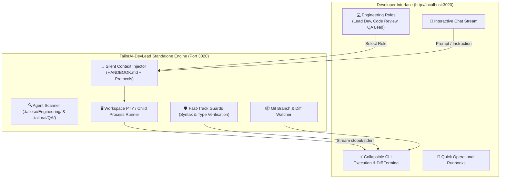

# Product Requirements Document (PRD) — TailorAI-DevLead Console 💻⚡
### Autonomous AI Developer Cockpit & CLI Execution Console

**Platform:** Cybeasy TailorAI-DevLead Platform  
**Document Code:** `PRD-TAILORAI-DEVLEAD-001`  
**Status:** Approved Architecture Blueprint 🚀  
**Target Audience:** Software Developers, Technical Leads & QA Engineers  
**Architecture Mode:** Standalone Local Micro-Dashboard (Port `3020`)  
**Advisory Intelligence Provider:** Google Gemini API  

---

## 1. Problem Statement & Motivation

As modern software projects scale in complexity, managing engineering tasks, architectural compliance, and testing lifecycles through manual terminal commands creates developer friction:

1. **Terminal & Context Switching Friction:** Engaging specialized roles currently requires manually locating and referencing markdown files (e.g., `Lead_Developer.md`, `Code_Review.md`, `Agent_Testing.md`), remembering exact prompt syntax, and interpreting raw shell output.
2. **The Generic Chat Trap:** Off-the-shelf chatbot interfaces (ChatGPT, Open-WebUI) operate purely as theoretical advisors. They lack access to local project files, cannot run unit or E2E tests, cannot modify code, and cannot perform git operations in the repository.
3. **The Need for TailorAI-DevLead Console:** An ultra-lightweight, standalone Web Dashboard running locally on port `3020` that gives developers a **dedicated engineering cockpit**:
   - Direct channels for **Lead Developer (Agent 1)**, **Code Reviewer (Agent 2)**, and **QA Automation Lead (Agent 3)**.
   - Built-in terminal panel with real-time CLI subprocess streaming (`tsc --noEmit`, `php -l`, test execution, git status).
   - Fast-Track indicator for micro-changes (≤ 3 files) with automated syntax/type checks.
   - Zero heavy container dependencies (< 60 MB RAM, instant startup).

---

## 2. Core Developer Roles (Channels)

| Channel | Persona | Target Responsibilities | Execution Mode |
|---|---|---|---|
| **💻 Lead Developer** | Full-Stack Execution Lead (Agent 1) | Code implementation, refactoring, atomic task execution, and Fast-Track surgical fixes | CLI Execution & Code Writing |
| **🔍 Code Reviewer** | Architecture & Quality Auditor (Agent 2) | Static analysis, SRP adherence, security audits, and diff review | Advisory & Verification |
| **🧪 QA Lead** | QA Automation Lead (Agent 3) | Running unit/regression/live E2E test suites, headed browser tests, and managing `DEFECTS_LOG.md` | CLI Execution & Test Runner |

---

## 3. System Architecture

---

## 4. Dual-Track Execution Integration

When instructing the **Lead Developer**:
1. If the request modifies ≤ 3 files and does not touch migrations, auth, or public API contracts:
   - The console marks the turn as **🚀 Fast-Track**.
   - Executes surgical changes directly in the workspace.
   - Automatically runs non-destructive syntax checks (`php -l`, `tsc --noEmit`, etc.).
   - Displays git diff preview in the terminal panel.
   - Appends a single-line log to `PROJECT_MAP.md`.
2. If the request touches architectural boundaries:
   - The console enforces **🛡️ Full Protocol**, generating or updating the appropriate task file in `.tailorai/Tasks/`.

---

## 5. Verification & Acceptance Criteria

1. **Pure Developer Focus:** Zero marketing, finance, sales, or business channels. 100% focused on code, tests, and architecture.
2. **Resource Constraint:** Node.js memory footprint < 60 MB.
3. **Execution Safety:** Post-edit syntax/type check automatically runs on every file modification.

