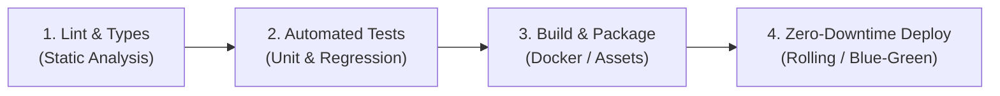

# Operational Runbook: CI/CD Pipeline 🔄

> **Location:** `.tailorai/Engineering/Runbooks/CI_CD_Pipeline.md`  
> **Project:** `{{PROJECT_NAME}}`

---

## 1. Pipeline Stages

The CI/CD pipeline consists of 4 automated stages:



---

## 2. Stage Breakdown

### Stage 1: Lint & Static Verification
- **Triggers:** Every Pull Request and commit.
- **Commands:**
  ```bash
  {{LINT_COMMAND}}
  {{TYPE_CHECK_COMMAND}}
  ```
- **Invariant:** Zero errors allowed. Any type or lint error blocks merge.

### Stage 2: Automated Tests
- **Triggers:** Pull requests targeted at `dev` or `main`.
- **Commands:**
  ```bash
  {{TEST_COMMAND}}
  ```

### Stage 3: Build & Artifact Generation
- **Triggers:** Merges into `main`.
- **Commands:**
  ```bash
  {{BUILD_COMMAND}}
  ```

### Stage 4: Production Deployment
- **Triggers:** Tagged release or merge into `main`.
- Executes rolling restart or blue-green container deployment with automated health check verification.

